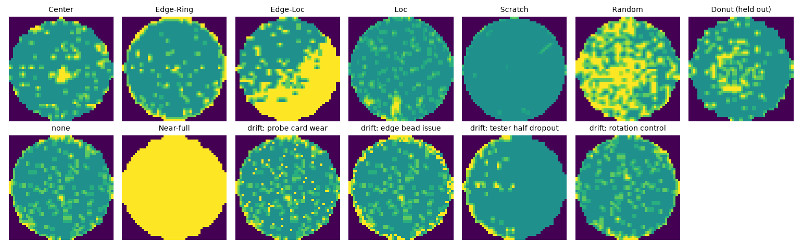

# WaferGate

A wafer-map defect classifier that has to earn its way into production.

When a fab tests every die on a wafer, the pattern of failing dies (a ring at the edge, a blob in the
center, a scratch) points to a specific process or tool problem. I built a classifier for those
patterns on the real **WM-811K** dataset, and then built the part that usually gets skipped: a release
pipeline that decides whether a model is allowed to serve, refuses to guess on patterns it has never
seen, and stops serving when the incoming wafers drift.



## What it does

1. **Data.** 172,950 labeled WM-811K maps (Wu, Jang and Chen, IEEE TSM 2015). I area-pool each
   variable-size map to 48x48 (die mask + fail fraction), downsample the `none` class to 30,000, and
   split **by lot** (10,738 lots, zero lots shared between train/val/test). **Donut is held out of
   training entirely** and plays the role of a newly discovered failure mode.
2. **Two model families.** A Wu et al. style baseline (68 handcrafted features: region densities,
   Radon transform profiles, geometry of the largest failing region, fed to gradient boosting) and a
   small CNN trained with class weights and wafer-symmetry augmentation. Both get temperature scaling.
3. **Abstain path.** The CNN ships with a Mahalanobis-distance scorer on its penultimate features;
   wafers that sit far from every known class come back as `ABSTAIN` and go to an engineer. The
   threshold is set on validation for about 5% in-distribution abstains.
4. **Registry + promotion gate.** Every candidate is logged to MLflow (local sqlite), registered as a
   new version of `wafer-defect-classifier`, and judged against [`policy.json`](policy.json):
   macro-F1 floor, per-class recall floor, calibration (ECE) ceiling, unseen-pattern AUROC floor,
   abstain-rate ceiling, and once a champion exists, a minimum gain and a max per-class regression.
   Passing candidates get the `champion` alias; failing ones are tagged `blocked` with the rules they broke.
5. **Audit trail.** Each decision is appended to [`results/audit/decisions.jsonl`](results/audit/decisions.jsonl)
   with the model hash, the data split hash and the previous record's hash, so editing an old decision
   breaks the chain.
6. **Drift monitor.** Production batches (400 wafers, no labels) are compared to the validation window
   with PSI on physical statistics (fail rate, 4 radial rings, quadrant asymmetry) plus the abstain
   rate. I simulate three tool problems on real test wafers (worn probe card, edge-bead/chuck issue,
   tester dropping half the fail bits) and one benign change (90 degree rotation) that should *not* block.
7. **Model card.** [`MODEL_CARD.md`](MODEL_CARD.md) is generated from `results/results.json`, so it can't drift from the run.

## Results

All numbers come from one run of `python -m wafergate.run_all` and are in
[`results/results.json`](results/results.json). Test split: 7,964 wafers from held-out lots, 8 known classes.

**Classification**

| model | macro-F1 | accuracy | ECE | Scratch recall | Random recall | Loc recall |
|---|---|---|---|---|---|---|
| handcrafted features + gradient boosting | 0.887 | 0.929 | 0.008 | 0.780 | 0.847 | 0.760 |
| CNN, unweighted, 3 epochs ("rushed retrain") | 0.793 | 0.917 | 0.008 | 0.097 | 0.847 | 0.670 |
| **CNN, class-weighted, 12 epochs (champion)** | **0.898** | **0.946** | **0.005** | **0.849** | **0.918** | **0.812** |

**Unseen pattern (555 Donut wafers the models never saw)**

| abstain method on the champion CNN | AUROC | Donut abstained | in-distribution abstain rate |
|---|---|---|---|
| max softmax probability (baseline) | 0.600 | 77 / 555 (13.9%) | 5.4% |
| **Mahalanobis on CNN features** | **0.975** | **441 / 555 (79.5%)** | **4.3%** |

**Release gate**

| version | candidate | decision | rule broken |
|---|---|---|---|
| v1 | gradient boosting baseline | blocked | unseen-pattern AUROC 0.719 < 0.75 |
| v2 | rushed CNN retrain | blocked | Scratch recall 0.097 < 0.50 |
| v3 | class-weighted CNN | **promoted** | none |

The champion reloaded from the registry (`models:/wafer-defect-classifier@champion`) reproduced the
in-memory model's predictions on 100% of test wafers, and the audit chain verifies.

**Drift monitor (20 batches x 400 wafers per scenario)**

| scenario | batches blocked | macro-F1 if served anyway |
|---|---|---|
| clean | 0 / 20 | 0.899 |
| worn probe card | 20 / 20 | 0.853 |
| edge-bead / chuck issue | 20 / 20 | 0.736 |
| tester drops half the fail bits | 20 / 20 | 0.744 |
| 90 degree rotation (benign control) | 0 / 20 | 0.895 |

## Run it

```bash
python3 -m venv .venv && . .venv/bin/activate
pip install -r requirements.txt
pytest                          # 34 tests, includes a small end-to-end pipeline run
python -m wafergate.run_all     # full run, about 25 minutes on a laptop CPU
mlflow ui --backend-store-uri sqlite:///mlruns/mlflow.db   # browse runs, versions, tags
```

`data/wm811k_48.npz` is the preprocessed 48x48 cache (24 MB), so the full run works out of the box. To
rebuild it from the original 2 GB pickle, download `MIR-WM811K.zip` from the MIR Lab public dataset
page (an archived copy is on the Wayback Machine), then:

```bash
python -m wafergate.data --pkl MIR-WM811K/Python/WM811K.pkl --out data/wm811k_48.npz
```

## Layout

```
wafergate/data.py        load, area-pool to 48x48, lot-grouped split, split hash
wafergate/features.py    68 handcrafted features (density, Radon, geometry)
wafergate/models.py      CNN, gradient boosting, temperature scaling, deployable WaferModel
wafergate/ood.py         Mahalanobis and max-softmax unseen-pattern scores
wafergate/gate.py        promotion policy evaluation
wafergate/registry.py    MLflow logging/registration/aliases, hash-chained audit log
wafergate/drift.py       PSI monitor and simulated tool-drift scenarios
wafergate/run_all.py     reproduces results/results.json
wafergate/model_card.py  writes MODEL_CARD.md from results.json
```

## Honest limits

- The `none` class is downsampled from 147,431 to 30,000 to keep training on a laptop CPU, so class
  priors (and precision on defect classes) differ from a real production line.
- Near-full has only 14 test wafers, so its 1.000 recall is a small-sample number.
- The CNN's macro-F1 gain over the handcrafted baseline is about 1.1 points; the bigger differences are
  on Scratch/Random/Loc recall and on the unseen-pattern detection.
- Donut is the only held-out pattern I tested. Abstain precision on Donut is 56% because Donuts are
  rare next to 7,964 in-distribution wafers; in practice abstains go to a human queue, not a scrap bin.
- Drift scenarios are simulated perturbations of real wafer maps, not recordings of a real tool
  excursion. Worn-probe-card batches are blocked even though macro-F1 only falls about 4.6 points;
  the monitor is deliberately conservative.
- Everything runs locally (MLflow with sqlite). The policy floors are my choices, set before the final run, not tuned to it.
